# Partie 2
## I. TP4
## Partie 0 : Préparation 
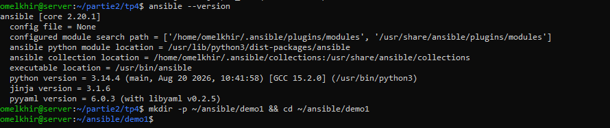
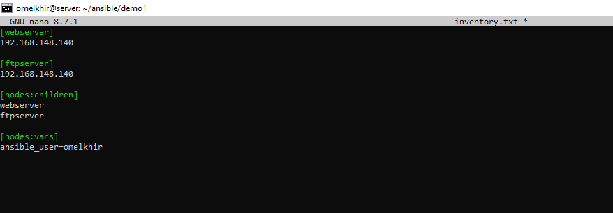
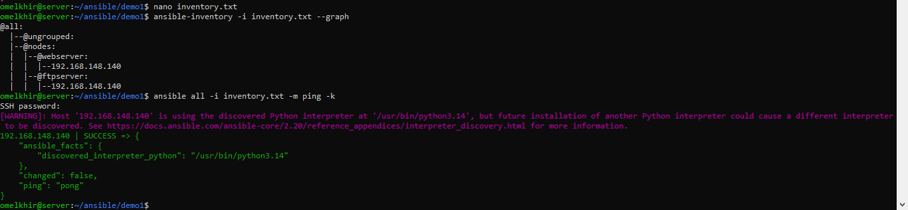
## Partie 1 : ansible.cfg
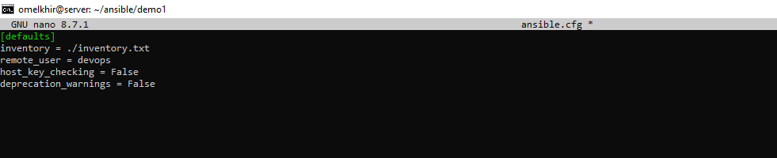
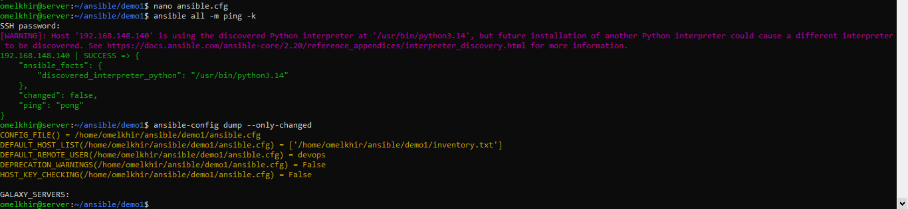
## Partie 2 : Premier playbook (Apache)
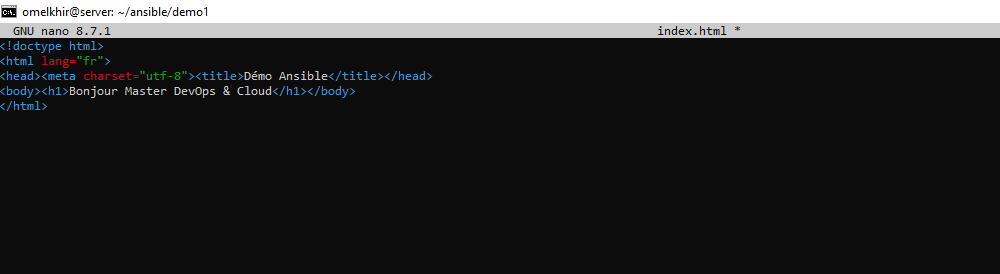
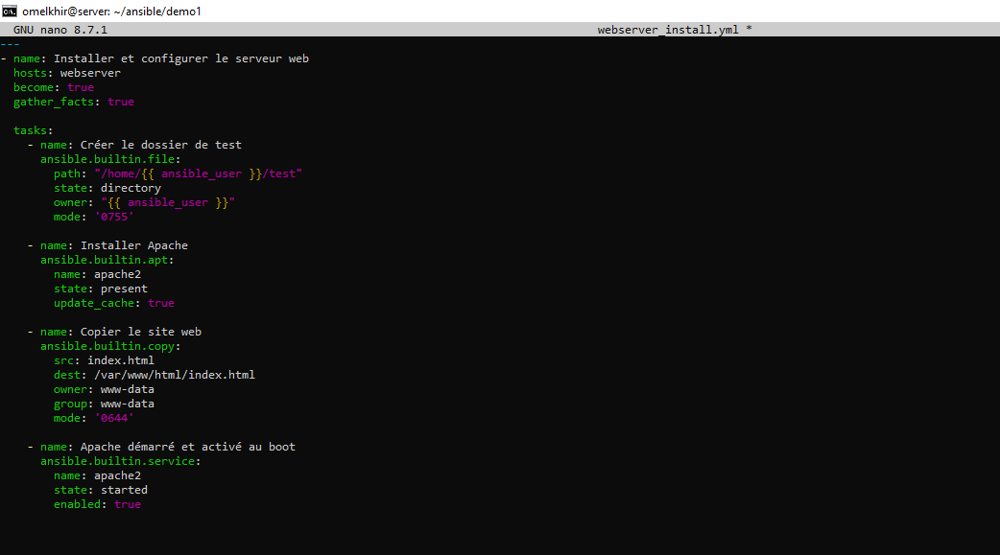
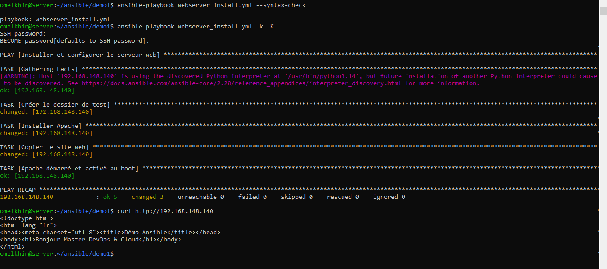
## Partie 3 : Clés SSH
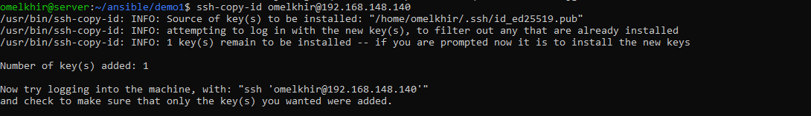
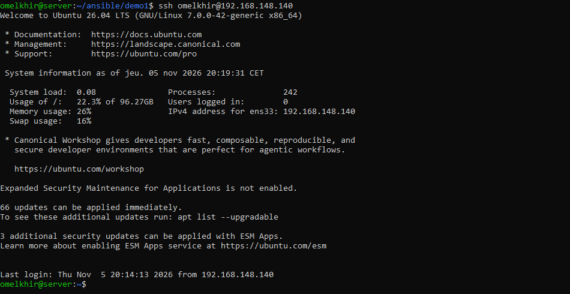
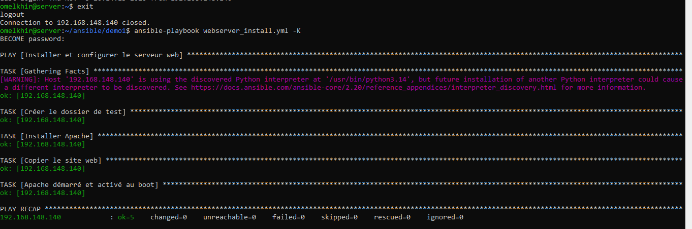
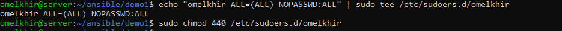
## Partie 4 : Docker, Jenkins, Portainer, conteneur web
### 4.1 Image Docker et Docker Hub
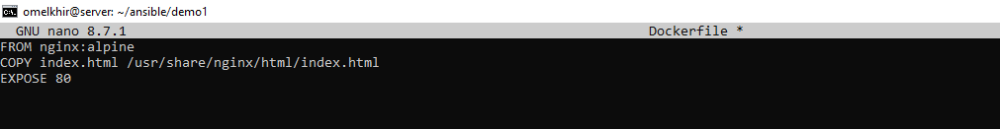
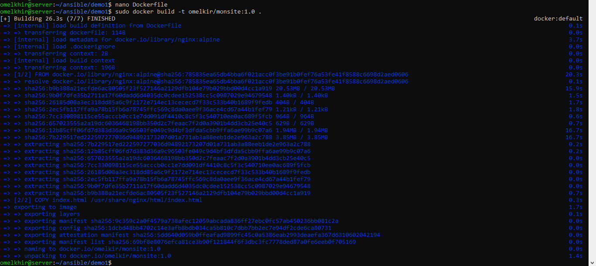
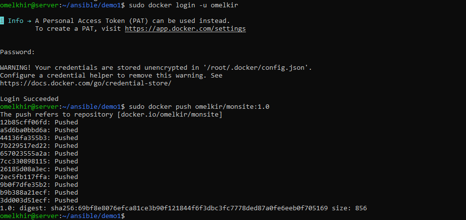
### 4.2 docker-compose.yml
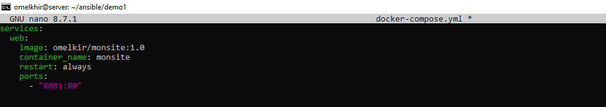
### 4.3 Playbook complet
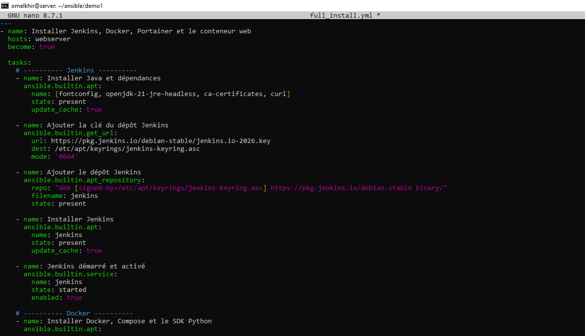
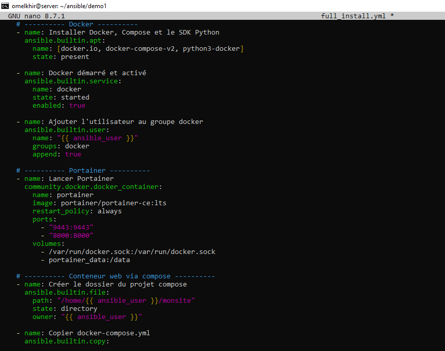
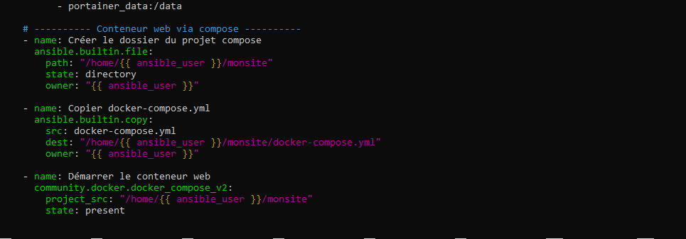
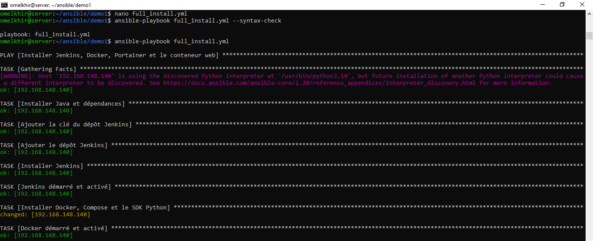
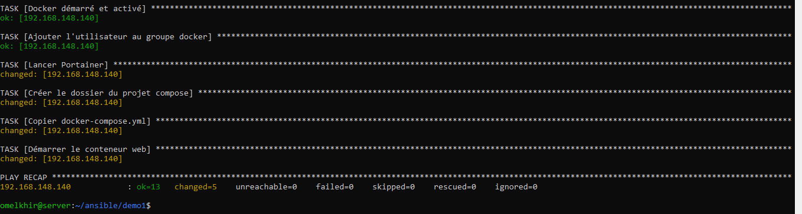
### 4.4 Tests (navigateur)
### Jenkins
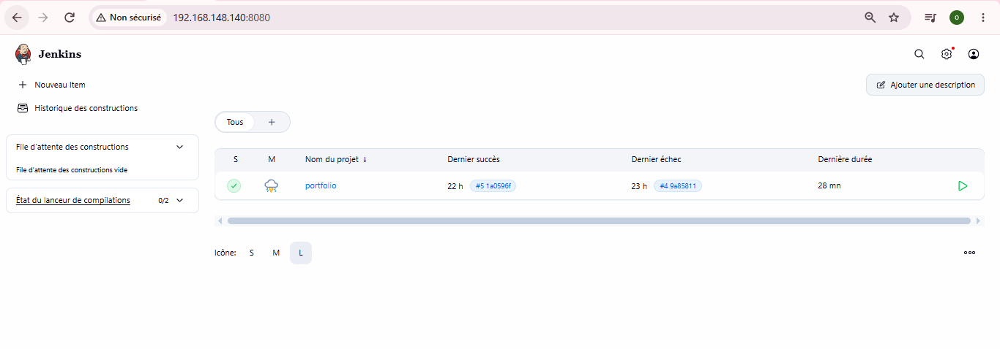
### Portainer
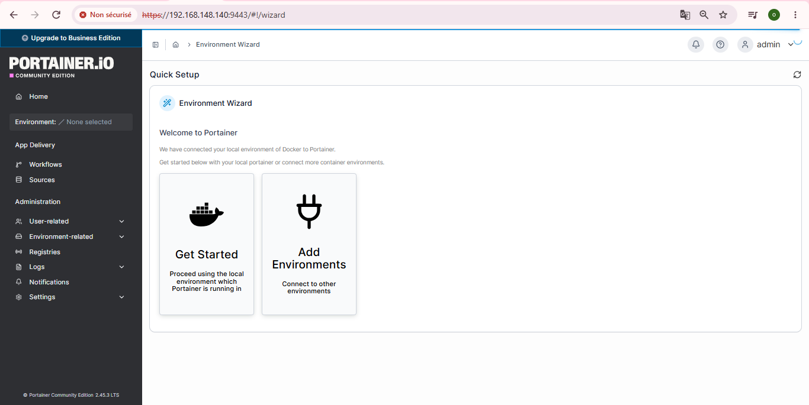
### Conteneur web
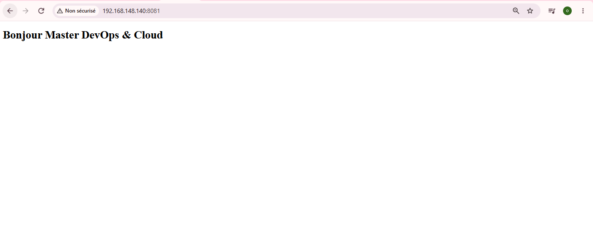
### Apache
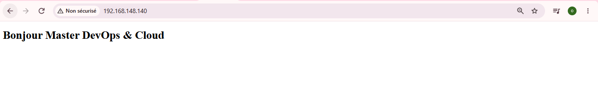
## Partie 5 : Même chose avec des rôles
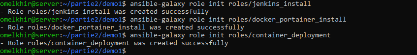
### roles/jenkins_install/tasks/main.yml
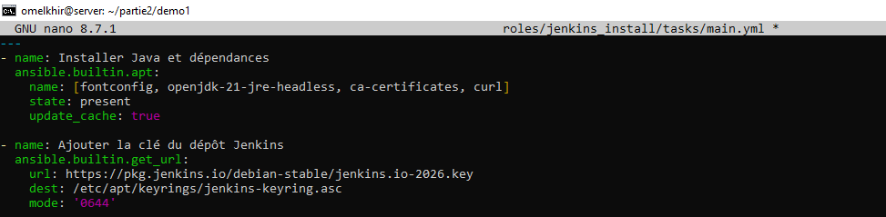
### roles/docker_portainer_install/tasks/main.yml
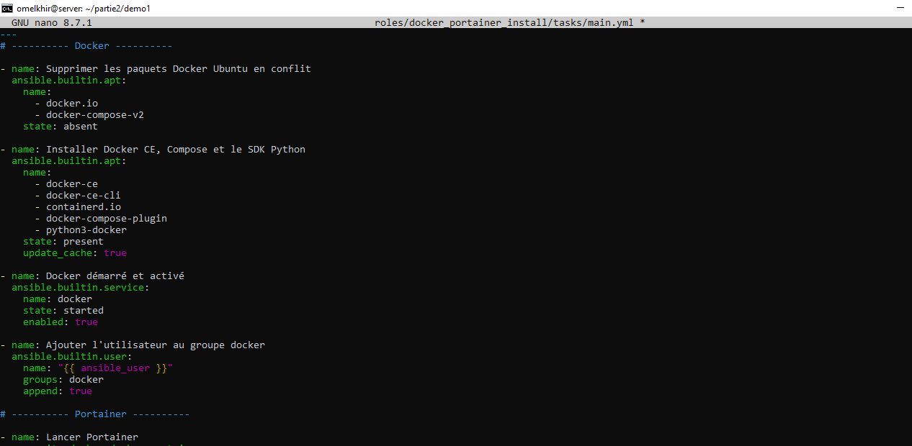
### roles/container_deployment/tasks/main.yml
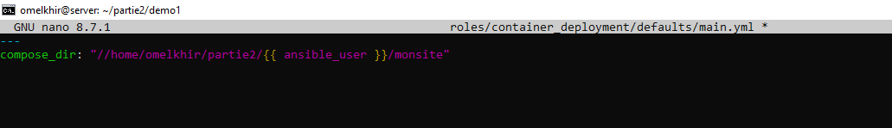
### site.yml
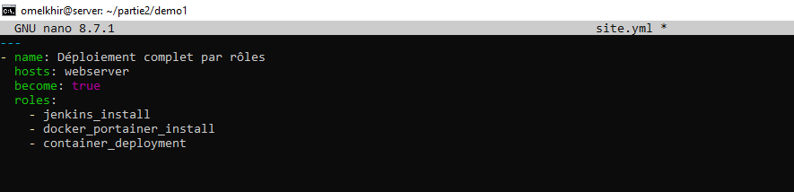
### roles-run
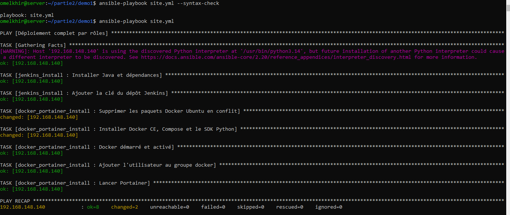
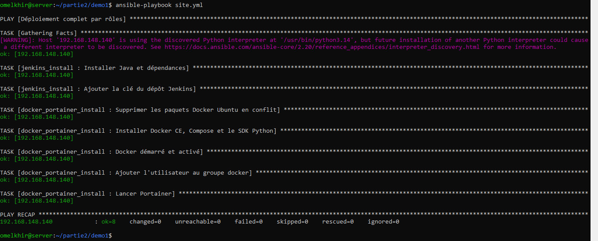
