# Partie 2 (TP4+TP5+TP6)
## I. TP4
## Partie 0 : Préparation 

## Partie 1 : ansible.cfg

## Partie 2 : Premier playbook (Apache)

## Partie 3 : Clés SSH

## Partie 4 : Docker, Jenkins, Portainer, conteneur web
### 4.1 Image Docker et Docker Hub

### 4.2 docker-compose.yml

### 4.3 Playbook complet

### 4.4 Tests (navigateur)
### Jenkins

### Portainer

### Conteneur web

### Apache

## Partie 5 : Même chose avec des rôles

### roles/jenkins_install/tasks/main.yml

### roles/docker_portainer_install/tasks/main.yml

### roles/container_deployment/tasks/main.yml

### site.yml

### roles-run

## II. TP5
## Étape 1 : activer la virtualisation imbriquée dans VMware + Étape 2 : installer VirtualBox, Ansible et Vagrant
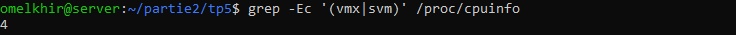
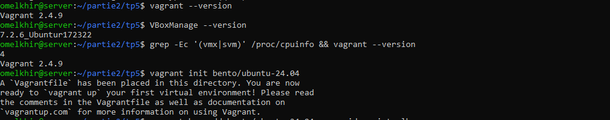
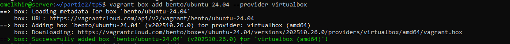
## Étape 3 : découvrir les commandes (rapide)
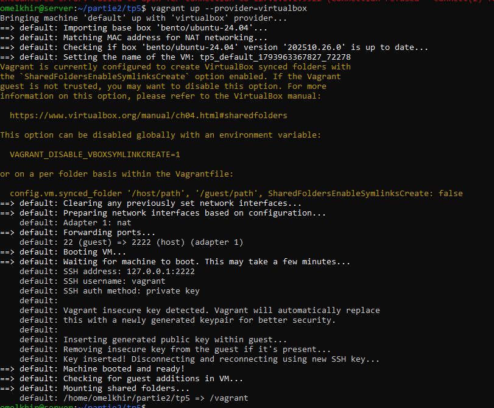
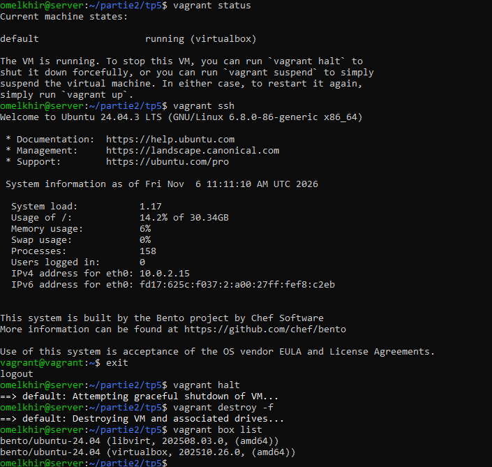
## Étape 4 : démo vagrant_demo
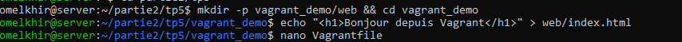
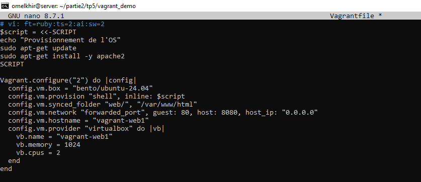
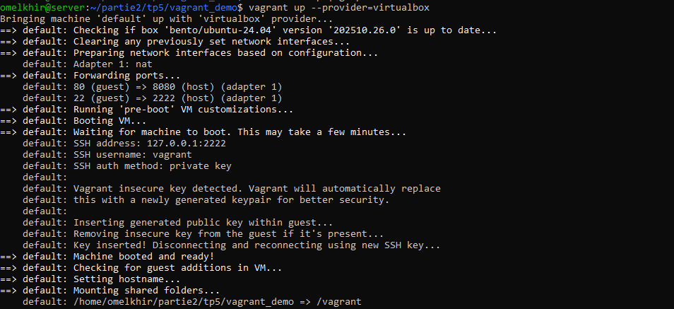
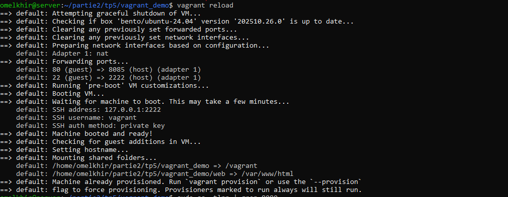
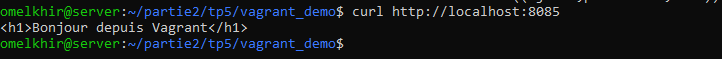
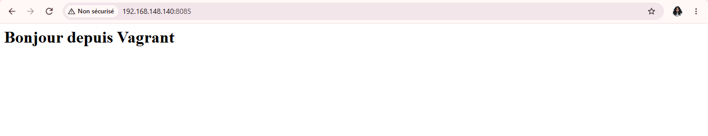
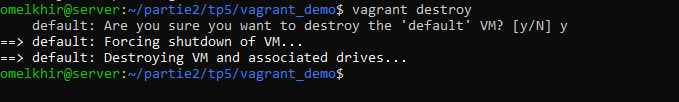
## Étape 5 : le lab (2 VM + Ansible)
### 5.1 Structure du dossier
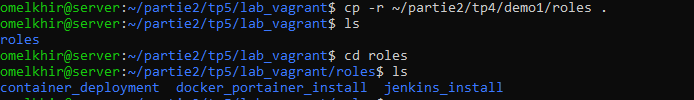
### 5.2 Vagrantfile
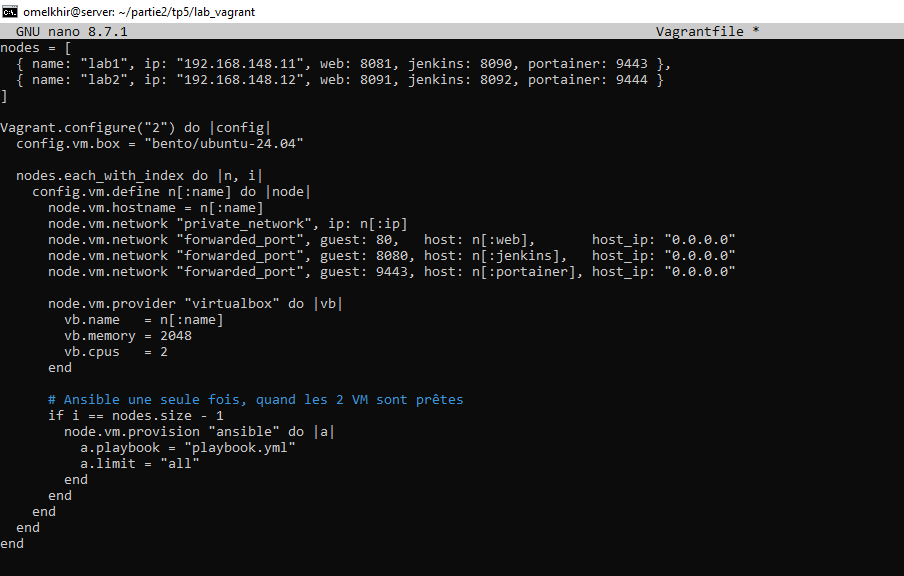
### 5.3 playbook.yml
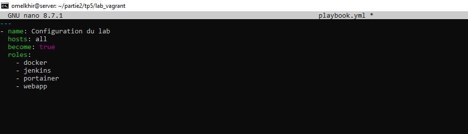
### 5.4 Rôles 
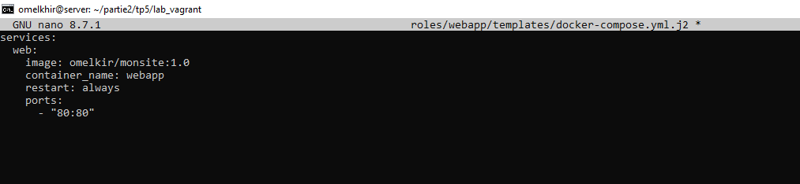
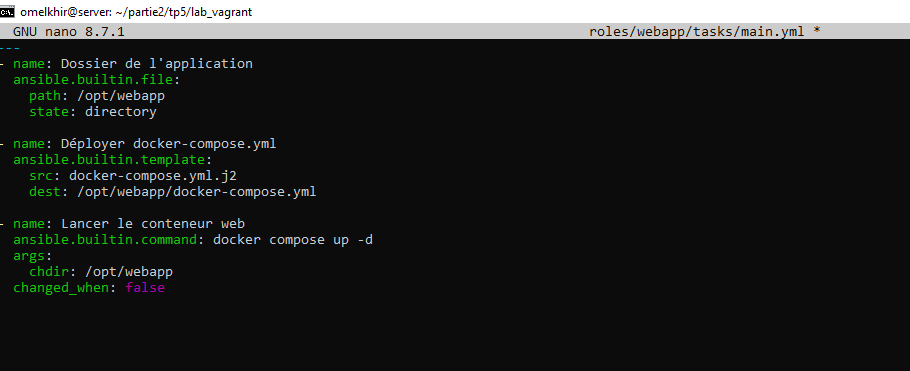
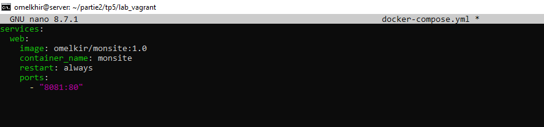
### 5.5 Lancer le lab
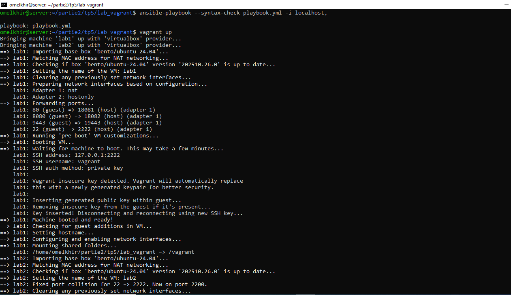
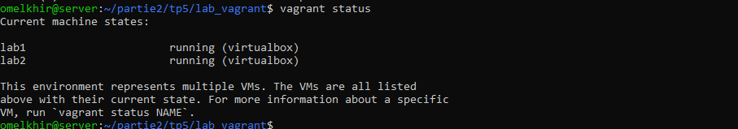
